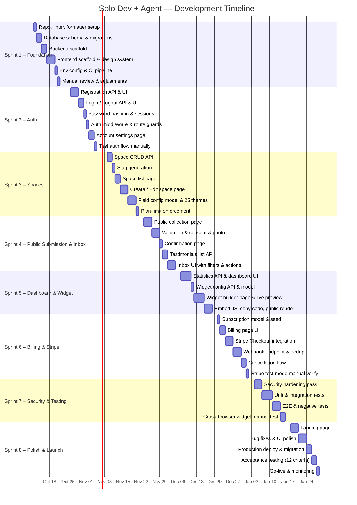
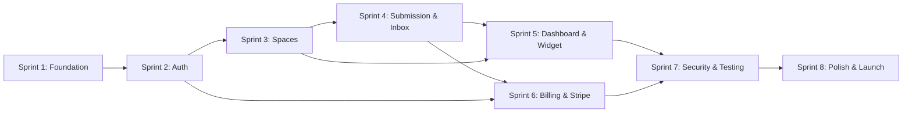

# Testimonial SaaS — WBS & Development Plan (Solo Dev + AI Agent)

> [!NOTE]
> Derived from [testimonial_saas_prd.md](file:///c:/Users/BS01390/OneDrive%20-%20Brain%20Station%2023/Desktop/testimonial-saas/PRD/testimonial_saas_prd.md)
> **Team:** 1 developer + AI coding agent

---

## Solo + Agent Workflow

| You (Developer) | AI Agent |
|-----------------|----------|
| Architecture decisions & tech stack choices | Scaffold projects, boilerplate, config files |
| Design system direction & UX decisions | Generate components, pages, CSS themes |
| Stripe account setup & dashboard config | Write Stripe integration code, webhook handlers |
| Manual testing & browser verification | Write unit, integration, and E2E test code |
| Deployment & infrastructure provisioning | Generate CI/CD configs, Dockerfiles, env templates |
| Code review & quality judgment | Implement features, fix bugs, refactor |
| PRD interpretation & priority calls | Generate migrations, API routes, validation logic |

> [!TIP]
> **Maximize agent leverage:** For each task below, items marked with 🤖 are ideal for full agent delegation. Items marked with 👤 need your direct input/decision. Items marked with 🤝 work best as collaborative back-and-forth.

---

## Part 1 — Work Breakdown Structure (WBS)

### WBS Diagram

```mermaid
graph TD
    ROOT["1.0 Testimonial SaaS"]

    ROOT --> P1["1.1 Project Setup & Infrastructure"]
    ROOT --> P2["1.2 Authentication & User Management"]
    ROOT --> P3["1.3 Space Management"]
    ROOT --> P4["1.4 Collection Form & Public Submission"]
    ROOT --> P5["1.5 Testimonial Inbox & Management"]
    ROOT --> P6["1.6 Dashboard & Analytics"]
    ROOT --> P7["1.7 Widget Builder & Embed"]
    ROOT --> P8["1.8 Subscription & Billing"]
    ROOT --> P9["1.9 Security & Hardening"]
    ROOT --> P10["1.10 Testing & QA"]
    ROOT --> P11["1.11 Deployment & Launch"]

    P1 --> P1A["1.1.1 Repo & monorepo setup"]
    P1 --> P1B["1.1.2 Database schema & migrations"]
    P1 --> P1C["1.1.3 Backend framework & structure"]
    P1 --> P1D["1.1.4 Frontend framework & design system"]
    P1 --> P1E["1.1.5 CI / CD pipeline"]
    P1 --> P1F["1.1.6 Environment & secret management"]

    P2 --> P2A["1.2.1 Registration API & UI"]
    P2 --> P2B["1.2.2 Login / Logout API & UI"]
    P2 --> P2C["1.2.3 Password hashing & sessions"]
    P2 --> P2D["1.2.4 Auth middleware & route guards"]
    P2 --> P2E["1.2.5 Account settings page"]

    P3 --> P3A["1.3.1 CRUD API for spaces"]
    P3 --> P3B["1.3.2 Slug generation & uniqueness"]
    P3 --> P3C["1.3.3 Space list page"]
    P3 --> P3D["1.3.4 Create / Edit space page"]
    P3 --> P3E["1.3.5 Plan-limit enforcement (spaces + testimonials/space)"]

    P4 --> P4A["1.4.1 Field configuration model & API"]
    P4 --> P4B["1.4.2 Theme selection (25 presets)"]
    P4 --> P4C["1.4.3 Public collection page"]
    P4 --> P4D["1.4.4 Client & server validation"]
    P4 --> P4E["1.4.5 Consent capture"]
    P4 --> P4F["1.4.6 Confirmation page"]
    P4 --> P4G["1.4.7 Photo upload handling"]

    P5 --> P5A["1.5.1 Testimonials list API"]
    P5 --> P5B["1.5.2 Inbox UI"]
    P5 --> P5C["1.5.3 Feature / un-feature"]
    P5 --> P5D["1.5.4 Favorite toggle"]
    P5 --> P5E["1.5.5 Hide / un-hide"]
    P5 --> P5F["1.5.6 Soft-delete"]
    P5 --> P5G["1.5.7 Overflow menu"]

    P6 --> P6A["1.6.1 Statistics API"]
    P6 --> P6B["1.6.2 Dashboard cards"]
    P6 --> P6C["1.6.3 Time-series chart"]
    P6 --> P6D["1.6.4 Activity feed"]
    P6 --> P6E["1.6.5 Upgrade banner"]

    P7 --> P7A["1.7.1 Widget config API"]
    P7 --> P7B["1.7.2 Widget builder page"]
    P7 --> P7C["1.7.3 Live preview"]
    P7 --> P7D["1.7.4 Embed JS generation"]
    P7 --> P7E["1.7.5 Copy-code & instructions"]
    P7 --> P7F["1.7.6 Public widget endpoint (email stripped)"]
    P7 --> P7G["1.7.7 Public testimonial page (email stripped)"]

    P8 --> P8A["1.8.1 Subscription seed"]
    P8 --> P8B["1.8.2 Billing page UI"]
    P8 --> P8C["1.8.3 Stripe Checkout"]
    P8 --> P8D["1.8.4 Success / cancel returns"]
    P8 --> P8E["1.8.5 Webhook endpoint"]
    P8 --> P8F["1.8.6 Subscription updates"]
    P8 --> P8G["1.8.7 Cancellation flow"]
    P8 --> P8H["1.8.8 Webhook deduplication"]

    P9 --> P9A["1.9.1 Input validation"]
    P9 --> P9B["1.9.2 Ownership checks"]
    P9 --> P9C["1.9.3 Rate limiting"]
    P9 --> P9D["1.9.4 XSS sanitization"]
    P9 --> P9E["1.9.5 CORS & CSP"]
    P9 --> P9F["1.9.6 Security review"]

    P10 --> P10A["1.10.1 Unit tests"]
    P10 --> P10B["1.10.2 Integration tests"]
    P10 --> P10C["1.10.3 E2E tests"]
    P10 --> P10D["1.10.4 Negative tests"]
    P10 --> P10E["1.10.5 Cross-browser widget"]

    P11 --> P11A["1.11.1 Production provisioning"]
    P11 --> P11B["1.11.2 DB migration & seed"]
    P11 --> P11C["1.11.3 Stripe verification"]
    P11 --> P11D["1.11.4 Landing page"]
    P11 --> P11E["1.11.5 Acceptance testing"]
    P11 --> P11F["1.11.6 Go-live & monitoring"]
```

---

### WBS Dictionary

| WBS ID | Work Package | PRD Ref | Deliverable | Agent Mode |
|--------|-------------|---------|-------------|------------|
| **1.1.1** | Repo & monorepo setup | — | Repo, linter, formatter, README | 🤖 Full |
| **1.1.2** | Database schema & migrations | §5 | Migration files for 6 entities, FK, unique indexes | 🤖 Full |
| **1.1.3** | Backend framework & structure | — | Project scaffold with routes, controllers, services, middleware | 🤖 Full |
| **1.1.4** | Frontend framework & design system | — | App shell, global styles, tokens, layout components | 🤝 Collab |
| **1.1.5** | CI / CD pipeline | — | GitHub Actions config | 🤖 Full |
| **1.1.6** | Environment & secret management | FR-11 | `.env.example`, startup validation | 🤖 Full |
| **1.2.1** | Registration API & UI | FR-01 | `POST /api/auth/register`, sign-up page | 🤖 Full |
| **1.2.2** | Login / Logout API & UI | FR-01 | `POST /api/auth/login`, `POST /api/auth/logout`, login page | 🤖 Full |
| **1.2.3** | Password hashing & sessions | FR-01, FR-11 | bcrypt, JWT/session cookies | 🤖 Full |
| **1.2.4** | Auth middleware & route guards | FR-01 | Token/session verification middleware | 🤖 Full |
| **1.2.5** | Account settings page | §7 | Name edit, password change | 🤖 Full |
| **1.3.1** | CRUD API for spaces | FR-03 | RESTful endpoints scoped to owner | 🤖 Full |
| **1.3.2** | Slug generation & uniqueness | FR-03 | Auto-slug, collision handling | 🤖 Full |
| **1.3.3** | Space list page | FR-03 | Grid of spaces with stats | 🤝 Collab |
| **1.3.4** | Create / Edit space page | FR-03, FR-04 | Form with field config, theme picker, rating toggle; **display public URL after creation** | 🤝 Collab |
| **1.3.5** | Plan-limit enforcement | FR-03, FR-09 | Server check: Free ≤ 3 spaces / Pro ≤ 25 spaces **AND** Free ≤ 100 testimonials/space / Pro ≤ 1,000 testimonials/space | 🤖 Full |
| **1.4.1** | Field configuration model | FR-04 | JSON config on Space entity | 🤖 Full |
| **1.4.2** | 25 theme presets | FR-04 | CSS presets, preview thumbnails | 🤝 Collab |
| **1.4.3** | Public collection page | FR-05 | Dynamic form from space config, themed | 🤝 Collab |
| **1.4.4** | Client & server validation | FR-05, FR-11 | Required fields, email, text length | 🤖 Full |
| **1.4.5** | Consent capture | FR-05 | Checkbox, separate boolean | 🤖 Full |
| **1.4.6** | Confirmation page | FR-05 | "Thank you" page | 🤖 Full |
| **1.4.7** | Photo upload | FR-04 | Upload endpoint, image storage | 🤝 Collab |
| **1.5.1** | Testimonials list API | FR-06 | Filtered, searched, paginated endpoint | 🤖 Full |
| **1.5.2** | Inbox UI | FR-06 | Table/cards with filters, search | 🤝 Collab |
| **1.5.3** | Feature / un-feature | FR-06 | Toggle API + UI | 🤖 Full |
| **1.5.4** | Favorite toggle | FR-06 | Toggle API + UI | 🤖 Full |
| **1.5.5** | Hide / un-hide | FR-06, FR-07 | Toggle, removes from public | 🤖 Full |
| **1.5.6** | Soft-delete | FR-06 | Set `deletedAt`, confirmation modal | 🤖 Full |
| **1.5.7** | Overflow menu | FR-06 | Context menu for secondary actions | 🤖 Full |
| **1.6.1** | Statistics API | FR-02 | Counts + time-series endpoint | 🤖 Full |
| **1.6.2** | Dashboard cards | FR-02 | Summary stat cards | 🤖 Full |
| **1.6.3** | Time-series chart | FR-02 | Chart with date-range filter | 🤝 Collab |
| **1.6.4** | Activity feed | FR-02 | Recent submissions list | 🤖 Full |
| **1.6.5** | Upgrade banner | FR-02, FR-09 | Conditional banner | 🤖 Full |
| **1.7.1** | Widget config API | FR-08 | CRUD for WidgetConfiguration | 🤖 Full |
| **1.7.2** | Widget builder page | FR-08 | Layout, theme mode, color, animation controls | 🤝 Collab |
| **1.7.3** | Live preview | FR-08 | Real-time preview panel | 🤝 Collab |
| **1.7.4** | Embed JS generation | FR-08 | `<script>` snippet with IDs | 🤖 Full |
| **1.7.5** | Copy-code & instructions | FR-08 | Copy button, integration guide | 🤖 Full |
| **1.7.6** | Public widget endpoint | FR-08 | Unauthenticated JS/HTML serving; **strip submitter emails from response** | 🤖 Full |
| **1.7.7** | Public testimonial page | FR-07 | Eligible testimonials, featured first; **do not expose submitter emails** | 🤝 Collab |
| **1.8.1** | Subscription seed | FR-09 | Auto Free plan on registration | 🤖 Full |
| **1.8.2** | Billing page UI | FR-10 | Plan cards, badge, upgrade CTA | 🤝 Collab |
| **1.8.3** | Stripe Checkout session | FR-10 | Checkout API, redirect | 🤖 Full |
| **1.8.4** | Success / cancel returns | FR-10 | Return pages, status display | 🤖 Full |
| **1.8.5** | Webhook endpoint | FR-10, FR-11 | Signature verification | 🤖 Full |
| **1.8.6** | Subscription status update | FR-10 | Event parsing, DB update | 🤖 Full |
| **1.8.7** | Cancellation flow | FR-10 | Cancel → Stripe API → webhook | 🤖 Full |
| **1.8.8** | Webhook deduplication | FR-10, FR-11 | Idempotent via WebhookEvent table | 🤖 Full |
| **1.9.1–1.9.5** | Security hardening | FR-11 | Validation, auth, rate limit, XSS, CORS | 🤖 Full |
| **1.9.6** | Security review | FR-11 | Manual audit checklist | 👤 You |
| **1.10.1–1.10.4** | Automated tests | §8, §9 | Unit, integration, E2E, negative | 🤖 Full |
| **1.10.5** | Cross-browser widget test | §8 | Manual browser checks | 👤 You |
| **1.11.1–1.11.3** | Production deploy & Stripe verify | — | Infra, migrate, Stripe test | 👤 You |
| **1.11.4** | Landing page | §7 | Hero, features, pricing, CTA | 🤝 Collab |
| **1.11.5–1.11.6** | Acceptance & go-live | §9 | Final verification, monitoring | 👤 You |

---

## Part 2 — Development Plan

### Capacity Assumptions

| Parameter | Value |
|-----------|-------|
| Developer | 1 (you) |
| AI agent | Always available |
| Effective hours/sprint | ~40h (part of daily work) |
| Sprint length | 2 weeks |
| Sprints | 8 |
| Total timeline | Oct 12 → Feb 5 |

> [!NOTE]
> With heavy agent delegation on 🤖 tasks, effective output is roughly 1.5–2× a solo dev. The plan accounts for this.

### Sprint Timeline

---

### Sprint Details

#### Sprint 1 — Foundation (Oct 12 – Oct 23)

| WBS | Task | Mode | Done When |
|-----|------|------|-----------|
| 1.1.1 | Init repo, ESLint, Prettier, Husky | 🤖 Agent generates all config | `npm run lint` passes on empty project |
| 1.1.2 | Write migrations: User, Space, Testimonial, Subscription, WidgetConfig, WebhookEvent | 🤖 Agent writes from PRD §5 | `migrate:up` succeeds, tables verified |
| 1.1.3 | Scaffold backend: routes, controllers, services, error handler, health endpoint | 🤖 Agent scaffolds | `GET /api/health` returns 200 |
| 1.1.4 | Scaffold frontend: app shell, design tokens, typography (Inter/Outfit), layout | 🤝 You pick direction, agent builds | Pages render with consistent styling |
| 1.1.5 | CI pipeline: lint → test → build | 🤖 Agent generates | Pipeline passes on push |
| 1.1.6 | `.env.example`, startup validation | 🤖 Agent generates | App refuses to start with missing vars |

> [!IMPORTANT]
> **Exit:** Project runs locally. `npm run dev` starts both backend and frontend. Database is seeded.

---

#### Sprint 2 — Authentication (Oct 26 – Nov 6)

| WBS | Task | Mode | Done When |
|-----|------|------|-----------|
| 1.2.1 | Registration API + sign-up page | 🤖 Agent builds full stack | ✓ New user can register, duplicate email rejected |
| 1.2.2 | Login / Logout API + page | 🤖 Agent builds full stack | ✓ Login returns token/session, logout clears it |
| 1.2.3 | bcrypt hashing, JWT or session cookies | 🤖 Agent implements | ✓ No plaintext passwords in DB |
| 1.2.4 | Auth middleware on private routes | 🤖 Agent implements | ✓ Unauthenticated requests get 401 |
| 1.2.5 | Account settings page | 🤖 Agent builds | ✓ Name editable, password change requires current password |
| — | Manual test: register → login → dashboard → logout → 401 | 👤 You test | **PRD AC-1 ✓** |

> [!IMPORTANT]
> **Exit:** PRD Acceptance Criterion 1 passes — user can register and log in.

---

#### Sprint 3 — Space Management (Nov 9 – Nov 20)

| WBS | Task | Mode | Done When |
|-----|------|------|-----------|
| 1.3.1 | Space CRUD API (scoped to ownerId) | 🤖 Agent builds | Create/read/update/delete work via API |
| 1.3.2 | Auto-slug from title, collision handling | 🤖 Agent builds | Duplicate titles → unique slugs |
| 1.3.3 | Space list page | 🤝 You review layout, agent builds | Shows all owner's spaces, empty state |
| 1.3.4 | Create / Edit space page | 🤝 You review UX, agent builds | All FR-04 fields configurable; **public URL displayed after creation** |
| 1.4.1 | Field config as JSON column + API | 🤖 Agent builds | Config round-trips correctly |
| 1.4.2 | 25 CSS theme presets | 🤝 You pick color palettes, agent generates CSS | Themes render distinctly |
| 1.3.5 | Free ≤ 3 / Pro ≤ 25 space enforcement + Free ≤ 100 / Pro ≤ 1,000 testimonials/space | 🤖 Agent builds | 4th space on Free → 403; 101st testimonial on Free space → 403 |

> [!IMPORTANT]
> **Exit:** PRD AC-2 (up to 3 spaces on Free) and AC-3 (configure fields, ratings, themes) pass.

---

#### Sprint 4 — Public Submission & Inbox (Nov 23 – Dec 4)

| WBS | Task | Mode | Done When |
|-----|------|------|-----------|
| 1.4.3 | Public collection page (dynamic form + theme) | 🤝 You verify UX, agent builds | Only enabled fields shown; theme applied |
| 1.4.4 | Client + server validation (incl. testimonial-per-space limit) | 🤖 Agent builds | Invalid data rejected with clear messages; **submission blocked if space testimonial cap reached** |
| 1.4.5 | Consent checkbox (separate boolean) | 🤖 Agent builds | Consent persisted independently |
| 1.4.7 | Photo upload (multipart / presigned) | 🤝 You decide storage, agent builds | Photo URL saved on Testimonial |
| 1.4.6 | Confirmation "thank you" page | 🤖 Agent builds | Shows after successful submit |
| 1.5.1 | Testimonials list API (filter, search, paginate) | 🤖 Agent builds | Filters and search work |
| 1.5.2 | Inbox UI with filters, search, overflow menu | 🤝 You review UX, agent builds | All metadata visible |
| 1.5.3–1.5.7 | Feature, favorite, hide, soft-delete actions | 🤖 Agent builds | Each action toggles correctly |

> [!IMPORTANT]
> **Exit:** PRD AC-4 (public submission), AC-5 (visible in inbox), AC-6 (feature/fav/hide/delete) pass.

---

#### Sprint 5 — Dashboard & Widget (Dec 7 – Dec 18)

| WBS | Task | Mode | Done When |
|-----|------|------|-----------|
| 1.6.1 | Statistics aggregation API | 🤖 Agent builds | Accurate counts + time-series from real data |
| 1.6.2 | Dashboard summary cards | 🤖 Agent builds | Numbers match DB |
| 1.6.3 | Time-series chart (7/30/90d) | 🤝 You pick chart lib, agent integrates | Chart updates on filter change |
| 1.6.4 | Recent activity feed | 🤖 Agent builds | Real submissions shown |
| 1.6.5 | Free-plan upgrade banner | 🤖 Agent builds | Hidden for Pro users |
| 1.7.1 | WidgetConfiguration CRUD API | 🤖 Agent builds | Config persists per space |
| 1.7.2 | Widget builder page | 🤝 You review UX, agent builds | Masonry/Carousel, light/dark, bg color, animation |
| 1.7.3 | Live preview | 🤝 You verify, agent builds | Preview updates in real-time |
| 1.7.4–1.7.5 | Embed code generation + copy + instructions | 🤖 Agent builds | Code is correct, copyable |
| 1.7.6 | Public widget rendering endpoint | 🤖 Agent builds | Serves eligible testimonials unauthenticated; **emails stripped from response** |
| 1.7.7 | Public testimonial display page | 🤝 You review, agent builds | Featured first, respects hidden/consent; **submitter emails never shown** |

> [!IMPORTANT]
> **Exit:** PRD AC-7 (dashboard stats) and AC-8 (widget configure/preview/copy/render) pass.

---

#### Sprint 6 — Billing & Stripe (Dec 21 – Jan 2)

| WBS | Task | Mode | Done When |
|-----|------|------|-----------|
| 1.8.1 | Auto Free subscription on registration | 🤖 Agent builds | New users → `plan: free, status: active` |
| 1.8.2 | Billing page UI | 🤝 You review, agent builds | Free → upgrade CTA; Pro → active badge |
| 1.8.3 | Stripe Checkout session creation | 🤖 Agent builds | Redirects to Stripe-hosted page |
| 1.8.4 | Success / cancel return pages | 🤖 Agent builds | Success shown after webhook confirms |
| 1.8.5 | Webhook endpoint + signature verification | 🤖 Agent builds | Invalid signatures → 400 |
| 1.8.6 | Subscription update from webhook events | 🤖 Agent builds | Plan/status updated correctly |
| 1.8.7 | Cancellation flow | 🤖 Agent builds | Cancel → Stripe → webhook → Free |
| 1.8.8 | Webhook deduplication | 🤖 Agent builds | Replayed events don't double-update |
| — | Manual Stripe test-mode end-to-end | 👤 You test with Stripe dashboard | **PRD AC-10 ✓** |

> [!IMPORTANT]
> **Exit:** PRD AC-9 (limits enforced) and AC-10 (Stripe test-mode checkout + webhooks) pass.

---

#### Sprint 7 — Security & Testing (Jan 4 – Jan 16)

| WBS | Task | Mode | Done When |
|-----|------|------|-----------|
| 1.9.1 | Server-side input validation audit | 🤖 Agent reviews & fixes all endpoints | No endpoint accepts unsanitized input |
| 1.9.2 | Ownership checks on all private endpoints | 🤖 Agent audits & patches | User A can't access User B's data |
| 1.9.3 | Rate limiting on public endpoints | 🤖 Agent adds middleware | Excessive submissions throttled |
| 1.9.4 | XSS sanitization (DOMPurify) | 🤖 Agent adds to all rendered output | Script payloads escaped |
| 1.9.5 | CORS & CSP for widget embed | 🤖 Agent configures | Widget loads on external domains |
| 1.9.6 | Manual security review | 👤 You walk through checklist | **PRD AC-11 ✓** |
| 1.10.1 | Unit tests (models, services, utils) | 🤖 Agent generates | ≥ 80% coverage, `npm test` green |
| 1.10.2 | Integration tests (auth, CRUD, limits, webhooks) | 🤖 Agent generates | API test suite passes |
| 1.10.3 | E2E tests (register → submit → inbox → widget) | 🤖 Agent generates | Happy paths automated |
| 1.10.4 | Negative tests (wrong owner, limits, invalid webhooks, XSS) | 🤖 Agent generates | All blocked correctly |
| 1.10.5 | Cross-browser widget testing | 👤 You test Chrome, Firefox, Safari, Edge | Widget renders in all |

> [!IMPORTANT]
> **Exit:** PRD AC-11 (no cross-user access) and AC-12 (automated tests cover happy + negative) pass.

---

#### Sprint 8 — Polish & Launch (Jan 18 – Jan 30)

| WBS | Task | Mode | Done When |
|-----|------|------|-----------|
| 1.11.4 | Landing page (hero, features, pricing, CTA) | 🤝 You direct design, agent builds | Responsive, SEO tags, premium feel |
| — | Bug fixes & UI polish from manual testing | 🤝 You report issues, agent fixes | No P0/P1 bugs remaining |
| — | Responsive design audit (desktop, tablet, mobile) | 👤 You test, 🤖 agent fixes | All pages responsive |
| 1.11.1 | Production environment provisioning | 👤 You set up hosting/DB | Infra running |
| 1.11.2 | Database migration & seed in production | 👤 You run, 🤖 agent provides scripts | Clean state |
| 1.11.3 | Stripe test-mode full verification | 👤 You verify | End-to-end payment flow works |
| 1.11.5 | Final acceptance against all 12 PRD criteria | 👤 You verify each | **All 12 AC pass ✓** |
| 1.11.6 | Go-live, error tracking, uptime monitoring | 👤 You configure | App live, alerts set |

> [!IMPORTANT]
> **Exit:** All 12 acceptance criteria verified. Application deployed and monitored. 🎉

---

### PRD Acceptance Criteria → Sprint Mapping

| AC# | Criterion | Sprint |
|-----|-----------|--------|
| 1 | Register and log in | Sprint 2 |
| 2 | Create up to 3 spaces on Free | Sprint 3 |
| 3 | Configure fields, ratings, themes | Sprint 3 |
| 4 | Public testimonial submission | Sprint 4 |
| 5 | Submission visible in inbox | Sprint 4 |
| 6 | Feature, favorite, hide, delete | Sprint 4 |
| 7 | Dashboard stats from real data | Sprint 5 |
| 8 | Widget configure, preview, copy, render | Sprint 5 |
| 9 | Free/Pro limits enforced | Sprint 6 |
| 10 | Stripe test-mode checkout + webhooks | Sprint 6 |
| 11 | No cross-user data access | Sprint 7 |
| 12 | Automated tests (happy + negative) | Sprint 7 |

---

### Risk Register (Solo Dev Specific)

| # | Risk | Impact | Likelihood | Mitigation |
|---|------|--------|------------|------------|
| R1 | **Burnout / context switching** | Velocity drops, bugs increase | High | Stick to sprint boundaries; don't work weekends; lean on 🤖 tasks |
| R2 | **Stripe webhook complexity** | Subscription stuck on Free | Medium | Implement polling fallback; test with Stripe CLI `stripe listen` |
| R3 | **Photo upload scope creep** | Delays Sprint 4 | Medium | Start with local disk; migrate to S3 later |
| R4 | **25 themes = design time sink** | Sprint 3 overruns | Medium | Build 5 distinct themes; remaining 20 are color variants (agent generates) |
| R5 | **Widget CORS/CSP on customer sites** | Widget fails to render | High | Dedicated endpoint with permissive CORS; test early with external HTML |
| R6 | **Single point of failure (you)** | Any illness stops all progress | Medium | Keep code well-documented; use agent to generate docs alongside code |
| R7 | **Agent-generated code quality** | Subtle bugs in generated code | Medium | Always review 🤖 output; run tests after each batch of changes |

---

### Dependency Map

---

### Definition of Done (per work package)

- [ ] Code works locally (`npm run dev`)
- [ ] Agent-generated code reviewed by you
- [ ] Server-side validation present for all inputs
- [ ] Ownership / auth checks verified
- [ ] At least one test covering the feature
- [ ] Responsive layout checked (desktop + mobile)
- [ ] Loading, empty, error, success states handled
- [ ] No secrets in code; env vars used
- [ ] Committed to `main` with descriptive message
